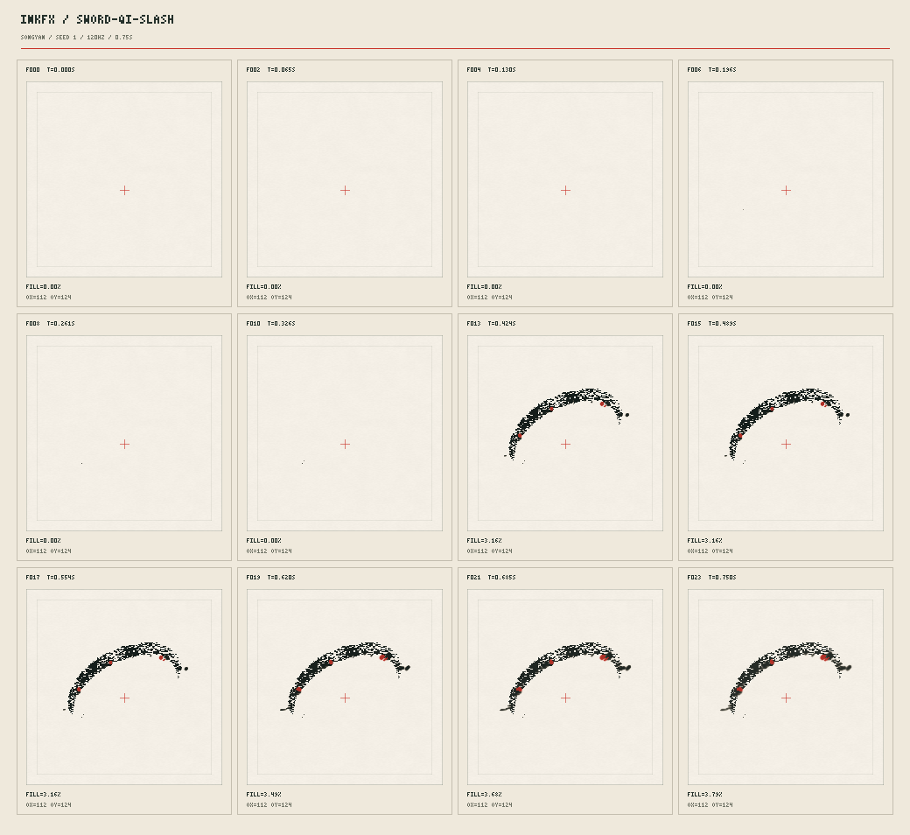

# inkfx

**墨起，意隨。A gesture becomes a world.**

水墨武俠程序化特效：用墨量、水分與宣紙纖維，畫出劍氣、飛白與水暈。每一筆由 seed 生成，無貼圖、無預錄動畫、零 npm 依賴。

Five gestures on virtual rice paper: 劍氣斬、十字劍氣、大筆橫掃、卷軸展開、墨點濺射。搭配松煙古墨、朱砂血墨、石青竹翠、泥金佛光四套礦物色盤，以 120Hz 模擬蓄力、出招、hit-stop 與殘墨。

Node.js 20+，不需安裝套件。

```sh
npm run gallery
# Open http://127.0.0.1:8080/gallery/

# Render one slash: annotated PNG + frame statistics
node tools/render.mjs sword-qi-slash --seed 42 --palette songyan
# → examples/out/sword-qi-slash/contact.png

# Discover all gestures, or render the full collection
node tools/render.mjs --list
npm run render
```



Gallery 可選招式、色盤與紙紋 seed，播放、拖曳時間，或儲存單幀 PNG。相同 seed 與時間得到相同墨跡；contact sheet 標示原點、幀號、秒數與填充率。

```js
import { create } from './src/fx/sword/sword-qi-slash.js';
import { composite } from './src/core/compositor.js';

const slash = create({ seed: 42 });
slash.step(0.6);
const rgba = composite(slash.frame, 'zhusha'); // Transparent Uint8ClampedArray
// composite(slash.frame, 'zhusha', { paper: true }) includes rice paper.
```

想寫自己的劍招，請看 [Authoring guide](docs/AUTHORING.md)。驗證：`npm test` 與 `node tools/check.mjs`。
