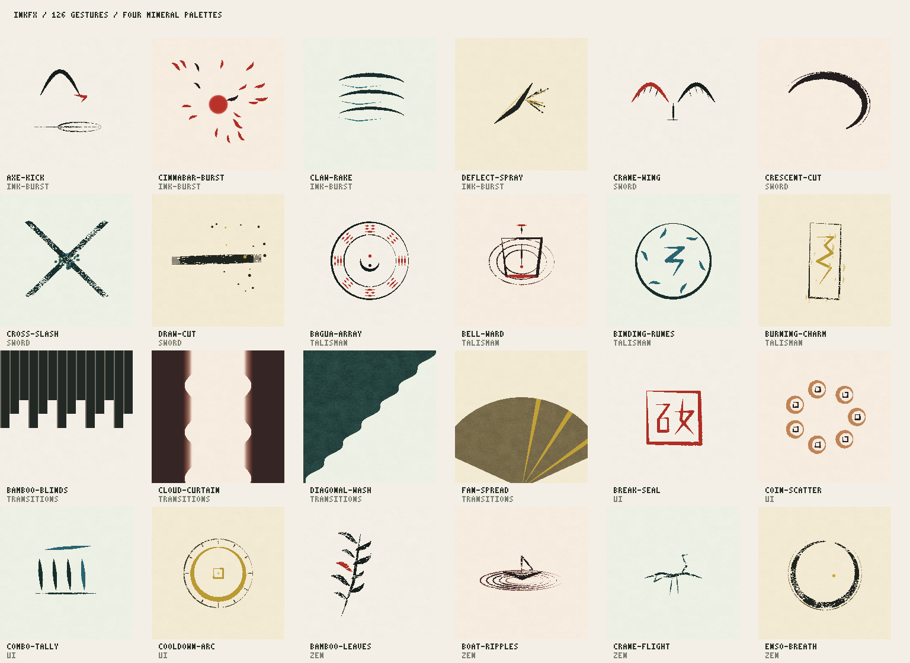

**English** | [繁體中文](README.zh-TW.md)

<p align="center"></p>
<h1 align="center">InkFX</h1>
<p align="center"><b>Ink in Motion · 墨起，意隨。</b></p>

       [](LICENSE)

**InkFX** is a procedural ink and wuxia effects library for games and interactive websites, with 132 effects and four palettes. Seeded rendering reproduces each stroke; the gallery previews and exports PNG sprite sheets, JSON atlases, and standalone ES modules.

[Live gallery](https://malilion.github.io/inkfx/) · [User guide](docs/AUTHORING.md) · [Demo video](examples/demo.mp4)



## Effects

| Category | ID | Count | Focus |
| :--- | :--- | ---: | :--- |
| Sword | `sword` | 27 | Sword trails and dry-brush arcs. |
| Talisman | `talisman` | 22 | Charms, arrays, and warding seals. |
| Zen | `zen` | 22 | Ambient leaves, smoke, and ripples. |
| Ink Burst | `ink-burst` | 21 | Strikes, shockwaves, and ink splashes. |
| Transitions | `transitions` | 20 | Ink wipes and scroll reveals. |
| UI & Seals | `ui` | 20 | Interface seals, tallies, and waypoints. |
| Total | | **132** | |

Action timelines include windup, hit-stop, and settle for game choreography.

## Palettes

- `songyan` — Pine soot: deep ink with a cinnabar accent.
- `zhusha` — Cinnabar: vermilion strokes and warm highlights.
- `shiqing` — Azurite jade: cool blue and bamboo green.
- `nijin` — Burnished gold: warm, luminous gold ink.

## Install

Requires Node.js 20+.

```sh
git clone https://github.com/malilion/inkfx.git && cd inkfx && npm ci
npm run gallery
```

The local gallery defaults to http://127.0.0.1:8080/gallery/ (override the port with the `PORT` environment variable).

## Usage

In a page within the repository, use `<script type="module">` with a `<canvas>`. `step(dt)` advances time in seconds; this example captures the frame at 0.6 seconds.

```js
import { getFX } from './src/index.js';

const { meta, create } = getFX('sword-qi-slash');
const canvas = document.querySelector('canvas');
canvas.width = meta.w;
canvas.height = meta.h;
const ctx = canvas.getContext('2d');
const fx = create({ seed: 42, palette: 'zhusha' });
const pixels = ctx.createImageData(meta.w, meta.h);
fx.step(0.6);
fx.draw(pixels);
ctx.putImageData(pixels, 0, 0);
```

List effects, or export a transparent PNG sheet and JSON atlas:

```sh
node tools/render.mjs --list
npm run export -- sword-qi-slash --seed 42 --palette zhusha --out artifacts/export/slash
```

## License

Copyright 2026 Malilion.

Licensed under [Apache-2.0](LICENSE). See [NOTICE](NOTICE) for attribution; the bundled **Noto Serif TC** font uses the [SIL Open Font License 1.1 (OFL-1.1)](gallery/fonts/OFL.txt).
