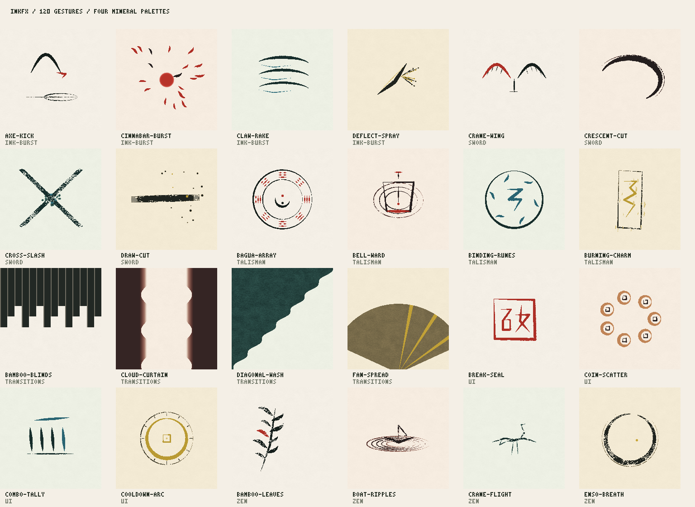
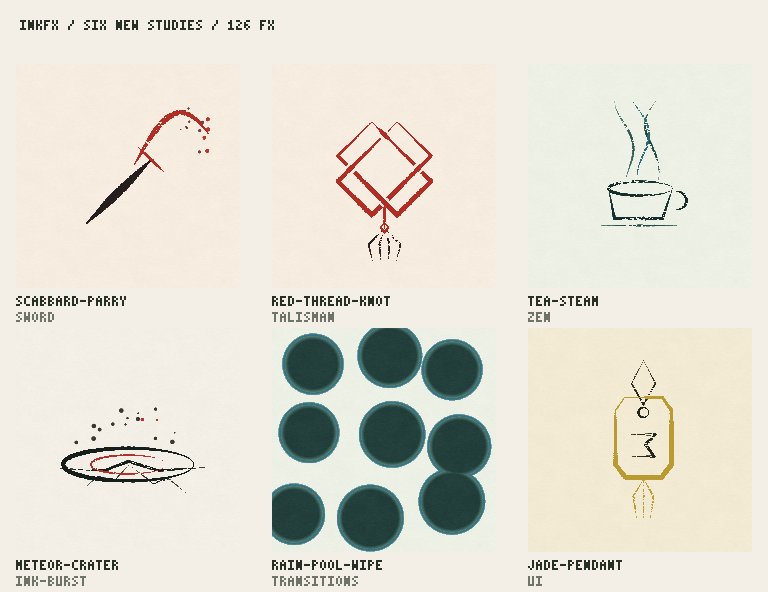

<!-- Language Selector / 語言切換分頁 -->

  <a href="README.md"><b>English</b></a> &nbsp;&nbsp;|&nbsp;&nbsp;
  <b>繁體中文</b>

---

  

<h1 align="center">InkFX 墨譜</h1>

  <b>墨起，意隨。</b>

  <strong>132 式即時程序化水墨特效 · 4 款東方礦物色階 · 120Hz 物理筆觸模擬 · 零外部依賴</strong>

  

  <a href="https://malilion.github.io/inkfx/"><strong>進入線上展廳 ↗</strong></a>
  &nbsp;·&nbsp;
  <a href="docs/AUTHORING.md"><strong>使用與串接指南 ↗</strong></a>
  &nbsp;·&nbsp;
  <a href="examples/demo.mp4"><strong>觀看 60fps 示範影片 ↗</strong></a>

---

**InkFX 墨譜** 是一套專為遊戲開發者、互動設計師與數位創作者打造的程序化東方水墨與武俠視覺特效庫。

不依賴預錄影片或龐大貼圖素材，每一道飛白劍氣、符陣結界、墨擊破空與禪境水暈，皆在虛擬宣紙上以 **120Hz 固定步進**即時演算而成。透過固定種子（Seed）即可百分百重現每一滴墨跡與每一絲飛白，並可直接於線上工作台調墨、換紙、預覽深色遊戲場景，一鍵匯出為跨引擎通用的 PNG 序列圖集、JSON Atlas 或獨立單檔 JS 模組。

### 1. 一式一景：六大類別、132 式水墨招式
從凌厲的拔刀斬擊、道家奇門符陣，到山水雲霧轉場與遊戲介面印記，涵蓋完整的武俠與東方美學視覺語彙：

| 分類 | 代號 | 數量 | 視覺定位與應用場景 |
| :--- | :--- | ---: | :--- |
| **劍式** | `sword` | **27** | 拔刀斬、回風旋斬、劍氣縱橫、流星斬、回風落雁等帶飛白與朱砂火星的刀劍軌跡 |
| **符陣** | `talisman` | **22** | 八卦陣、五行輪轉、五雷符、紅線結、北斗星圖、鎮魂印等陣法與結界特效 |
| **禪境** | `zen` | **22** | 禪圓呼吸、河燈夜渡、竹葉隨風、茶煙、寒江孤舟、松雪等可無縫循環的意境氛圍 |
| **墨擊** | `ink-burst` | **21** | 掌風破空、驚雷掌、隕墨墜、碎石震波、破防重擊等高張力打擊感爆發特效 |
| **轉場** | `transitions` | **20** | 雨池暈場、墨雨垂簾、捲軸展開、屏風折疊、燒紙、雲幕等全幅水墨過場遮罩 |
| **印記** | `ui` | **20** | 玉佩呈印、心法頓悟、勝字朱印、連擊計數、氣血丹爐、羅盤路標等東方介面回饋 |
| **合計** | | **132** | **全數支援固定種子重現、四色礦物色階與無損圖集匯出** |

### 2. 四款傳統東方礦物色階
內建四組取材自傳統書畫顏料的六階濃淡色盤與點睛朱砂／泥金，可於全站與匯出時自由切換：

- **松煙古墨（`songyan`）**：取松木焚煙入膠，濃淡六階層次分明，配一抹丹砂點睛。
- **朱砂血墨（`zhusha`）**：以天然辰砂入畫，赤紅破陣、氣勢凜然，適合暴擊、符咒與大招演出。
- **石青竹翠（`shiqing`）**：藍銅礦石青與竹翠交織，冷冽澄澈，適合寒冰劍氣、山嵐與水景。
- **泥金佛光（`nijin`）**：金箔研磨入墨，溫潤鎏金，適合境界突破、神聖法陣與高階印記。

### 3. 一念起，三折成招：內建武術打擊節奏（Act & Hit-Stop）
每一式特效不僅具備筆觸物理與宣紙纖維滲透，更內建針對遊戲打擊感設計的三階段時間軸：

1. **起勢蓄墨（Windup）**：筆鋒初落、墨氣向中心凝聚，提供清楚的出招預判。
2. **破空頓幀（Impact & Hit-Stop）**：濃墨破陣、朱砂飛濺，配合精確到毫秒的命中頓幀（Freeze）與鏡頭震動參數，定格張力巔峰。
3. **餘墨歸紙（Settle）**：飛白消散、濕墨自然滲入宣紙肌理，留白處餘韻不絕。

### 4. 沉浸式線上展廳與調墨工作台
打開 **[InkFX 線上展廳](https://malilion.github.io/inkfx/)**，即可體驗從觀賞、拆解到精調匯出的連貫流程：

- **首屏即時演出與「揮毫試劍」**：進站即演繹 3 秒「聚墨 → 出劍 → 餘墨」水墨片頭；滑鼠或手指在宣紙上滑過即可即時揮出帶飛白與朱砂火星的動態劍痕。
- **策展／圖鑑雙視角藏譜**：支援「策展畫廊（主打大卡交錯）」與「密集圖鑑」雙模式切換；卡片懸停即顯示「起勢 · 頓幀 · 收勢」節奏比例條，並可於藏譜直接切換四色礦物墨韻。
- **松煙暗室「墨法解構」**：以深松煙墨底展廳並置拆解當前招式的「起勢、頓幀、收勢」三幀 120Hz 實時切片。
- **專業預覽舞台與關鍵幀底片列**：
  - **三種舞台底色**：「宣紙（Rice Paper）」、「透明（Alpha 棋盤格）」、「玄夜（深色夜戰遊戲場景）」一鍵切換，立即確認特效在亮底或暗色遊戲畫面中的表現。
  - **洋蔥皮殘影（Onion Skin）**：疊加前序軌跡殘影，清楚檢視揮砍加速度與筆鋒路徑。
  - **5 格關鍵幀底片列**：自動擷取「起勢 → 出鋒 → 破空 → 頓幀 → 收勢」五格縮圖，點選任意格即刻跳幀檢視，並支援 `0.25×` 慢動作與木人樁受擊演出。

### 5. 即拿即用：從遊戲引擎到現代網頁
在工作台選定墨色、宣紙紋理與隨機種子後，可選擇最符合專案流程的帶走方式：

- **PNG 序列圖集 + JSON Atlas**：直接在瀏覽器本地即時烘焙無背景干擾的透明 PNG 圖集與對應 JSON（相容 **Phaser**、**Aseprite**、**Godot**、**PixiJS**、**Unity** 等主流引擎），JSON 內附完整座標原點與命中頓幀時間點。
- **零依賴單檔 JS 模組（`<effect-id>.mjs`）**：一鍵複製或下載獨立 ES Module，無須安裝任何套件即可直接放入網頁、Canvas 或 **React / Vue** 元件中即時渲染。

---

## 授權

Copyright 2026 Malilion.

本專案採 [Apache License, Version 2.0](LICENSE) 授權。第三方歸屬見 [NOTICE](NOTICE)，其中打包的 **Noto Serif TC** 字型採 SIL Open Font License 1.1（`gallery/fonts/OFL.txt`）。

